# React Native App Demo
=========================

A React Native app demo for awareness.

## Badges

[](https://opensource.org/licenses/MIT)
[](https://docs.expo.io/)

## Overview

This is a React Native app demo built using Expo, showcasing various features and components.

## Key Features

* Tab navigator
* About page
* Explore page
* Home page
* Signup page

## Technology Stack

* Languages: JavaScript (TSX)
* Frameworks: React Native, Expo
* Libraries:
	+ Expo Router
	+ React Navigation
	+ Redux
	+ React Native Reanimated
	+ Expo Haptics
	+ Expo Web Browser
	+ Expo Status Bar
	+ Expo Splash Screen
	+ Expo Constants
	+ Expo Fonts
	+ Expo Image
	+ Expo Linking
	+ Expo System UI
	+ Expo Web Browser
* Infrastructure: Expo CLI, Webpack, Babel

## Architecture

```mermaid
graph LR
    A[app/index.js] --> B[app/_layout.tsx]
    B --> C[components/UI]
    C --> D[components/UI/about.js]
    D --> E[components/UI/explore.tsx]
    E --> F[components/UI/home.js]
    F --> G[components/UI/signup.js]
    G --> H[redux/pizzaSlice.js]
    H --> I[redux/store.js]
    I --> J[app/index.js]
```



## Project Structure

```markdown
app/
  tabs/
    index.js
  _layout.tsx
  about.js
  explore.tsx
  home.js
  index.js
  signup.js
components/
  ui/
    about.js
    explore.tsx
    home.js
    signup.js
constants/
hooks/
redux/
  pizzaSlice.js
  store.js
scripts/
tsconfig.json
```

## Prerequisites

* Expo CLI installed on your machine
* Node.js installed on your machine
* npm installed on your machine

## Installation and Setup

1. Clone the repository using `git clone https://github.com/123-anubhav/react-native-app-demo.git`
2. Install the dependencies using `npm install`
3. Start the development server using `expo start`

## Environment Variables

* `REACT_NATIVE_APP_NAME`
* `REACT_NATIVE_APP_VERSION`

## How to Run the Application

1. Start the development server using `expo start`
2. Open the app on your device or emulator

## API Endpoints and Usage Examples

* No API endpoints are exposed in this demo

## Database or AI/RAG Workflow

None

## Testing Instructions

No tests are present in the repository

## Docker or Deployment Instructions

No deployment instructions are available

## Security Notes

* No security vulnerabilities are known at this time

## Limitations and Future Improvements

* The project's deployment process is not documented
* The project's testing process is not documented
* The project's build process is not documented

## Contribution and License

This project is licensed under the MIT License. Contributions are welcome, but please follow the standard contribution guidelines.